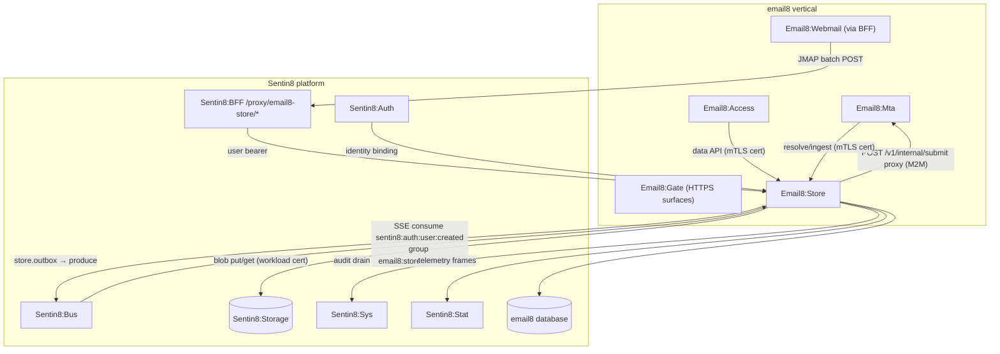
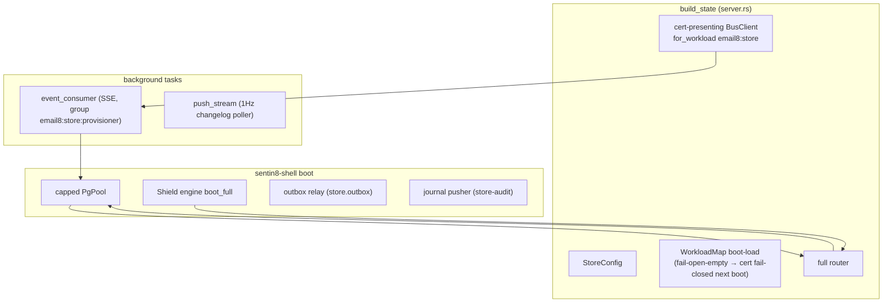
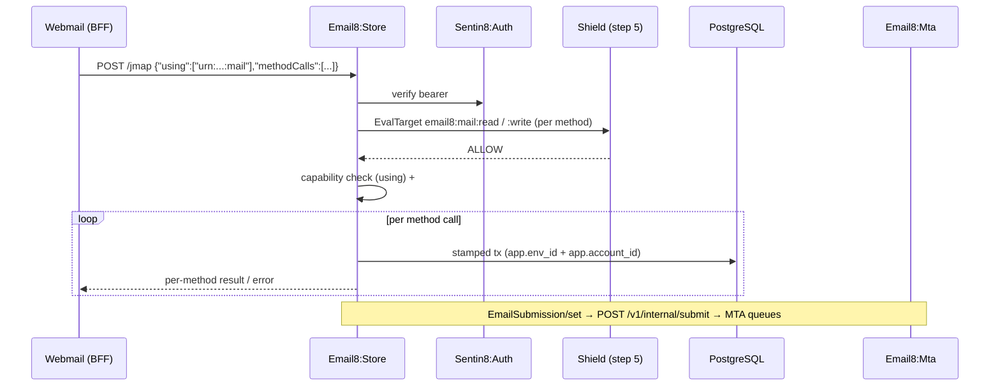
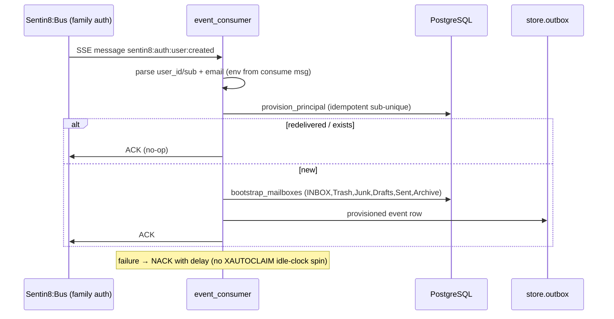
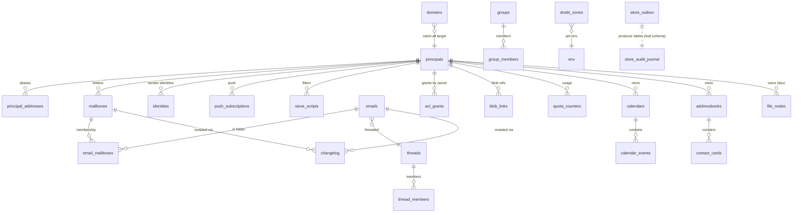
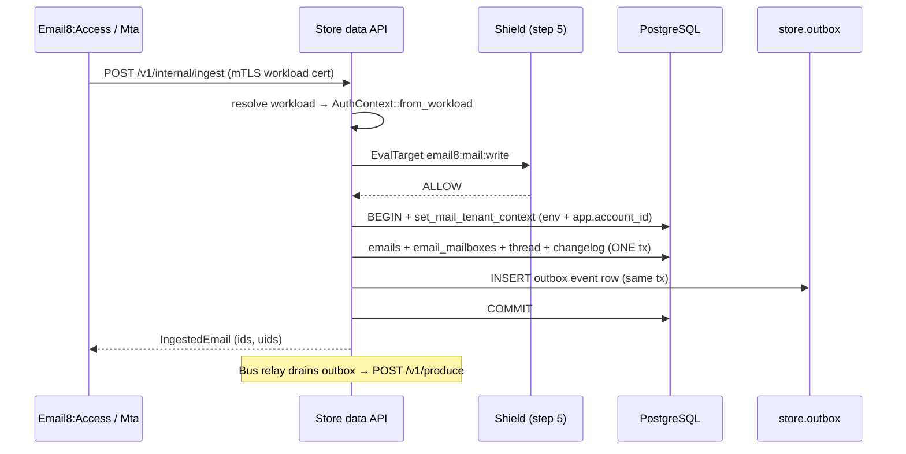
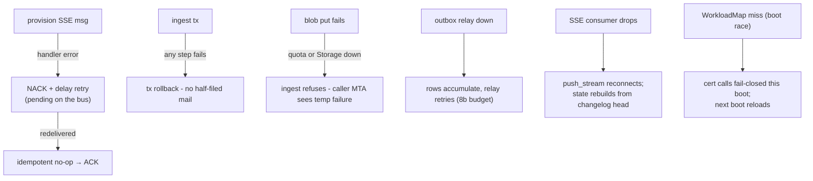
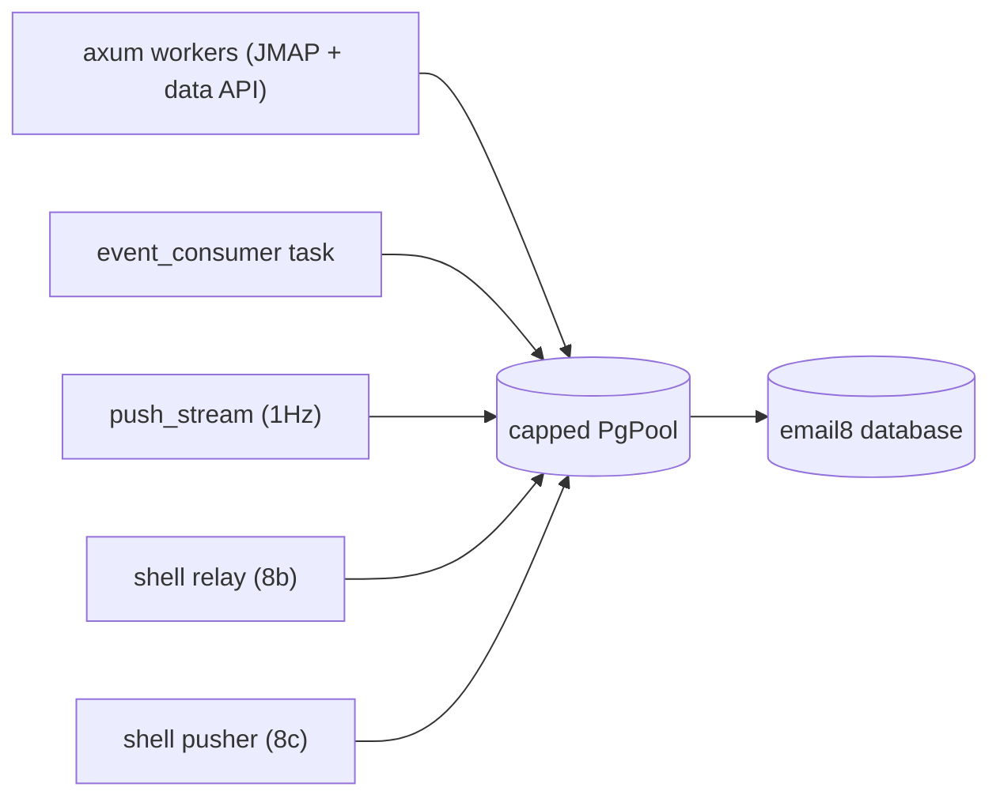
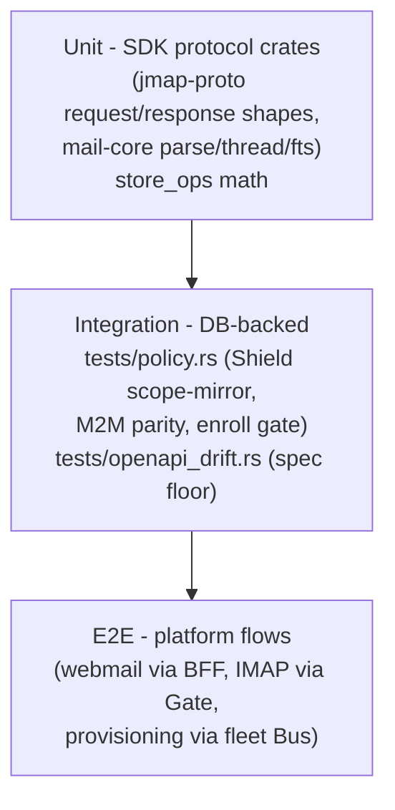

# Email8:Store - Detailed Design Document

## 1. Scope & Context

Email8:Store owns: the `email8` schema (principals, addresses,
mailboxes, emails, threads, changelog, ACL, blob links, identities,
sieve scripts, push subscriptions, groupware, groupware config tables),
the JMAP API (RFC 8620/8621 surface incl. RFC 8887 WebSocket and SSE
push), the internal typed data API consumed by the other mail services,
the provisioning Bus consumer, and the store leaf schema producer
objects (`store.outbox`, `store.audit_journal`).

It does NOT own: queue/delivery (Email8:Mta), protocol session
machines (Email8:Access), client ports (Email8:Gate), blob bytes
(Sentin8:Storage), or identity (Sentin8:Auth - principals bind to auth
users by id, provisioned from auth events).

Trust boundaries: JMAP clients arrive through the BFF with user
bearers; internal services cross with workload certificates only; the
provisioning consumer trusts only Bus-verified payloads.

## 2. Runtime Architecture

Boot is shell-owned (`Sentin8Shell::new("email8:store","EMAIL8_STORE")`):
pool + Shield engine + outbox relay (8b, `store_outbox_changed`) +
audit pusher (8c, `store-audit`).

Module map:

| Module | Responsibility |
|---|---|
| `jmap.rs` | RFC 8620 batch parser (`email8::jmap_proto`), per-method capability gating, `#ref` resolution, dispatch table; session resource; download/upload/eventsource/ws |
| `jmap_objects.rs` | Method implementations (mailbox/email/thread/identity/push-subscription/groupware/submission) |
| `data_api.rs` | Internal data API handlers (each: Shield action + one stamped tx + outbox emit) |
| `store_ops.rs` | Domain ops: id allocation, provisioning + bootstrap folders, ingest (parse→thread→spam refile→changelog→iMIP), `changes_since`, address resolution (sub-addressing/aliases/catch-all), group members |
| `auth.rs` | `require_mail_auth` (cert-first via WorkloadMap, bearer fallback), `MailAuth{auth,account_id}`, `set_mail_tenant_context`, `bind_account` (sub→principal) |
| `event_consumer.rs` | Bus SSE consumer (`sentin8:auth:user:created`), explicit ACK, NACK-with-delay |
| `push_stream.rs` | SSE EventSource feed for `/jmap/eventsource` (`event: state` + ping) |
| `admin_data.rs`/`admin_ui.rs` | RFW pages + data endpoints |
| `storage_auth.rs` | Storage blob client (cert identity) |

**JMAP request lifecycle:**

**Provisioning lifecycle (the auto-mail-account rule):**

## 3. Data Model

Shared schema `email8` for domain tables; leaf schema `store` carries
producer tables only (`store.outbox`, `store.audit_journal`) and leads
the `email8_store_service` search_path.

| Table | Key columns | RLS tier |
|---|---|---|
| `email8.principals` | id, env_id, sentin8_auth_user_id UNIQUE(env,sentid), name (primary address), display_name, locale, time_zone, quota_bytes, active_script_id, default_calendar_id/addressbook_id, is_group | env + SELECT holder-match on auth id; m2m `holder:view-all` branch |
| `email8.principal_addresses` | account_id, address UNIQUE(env,lower), is_primary | account (holder-or-admin) |
| `email8.domains` | env_id, name UNIQUE(env,lower), is_enabled, catch_all_account_id, sub_addressing_enabled, allow_relaying, report_address | **NO RLS** (mail-domain→env discovery catalog; the MTA resolves pre-tenant) |
| `email8.groups` / `group_members` | address UNIQUE / PK(group,member) | env |
| `email8.mailboxes` | PK(account,id), name, role (special-use), parent_id, sort_order, uid_validity, uid_next, is_subscribed, version | account |
| `email8.emails` | PK(account,id), env_id, blob_hash, thread_id, size, received_at, sent_at, message_id, subject, preview, keywords TEXT[], has_attachment, is_spam_score, deleted_at, metadata JSONB, thread_key, search_text; GIN(keywords), GIN(to_tsvector('simple', search_text)); idx thread/received/thread_key/message_id | account |
| `email8.email_mailboxes` | PK(account,email,mailbox), imap_uid; UNIQUE(account,mailbox,imap_uid) | account |
| `email8.threads` / `thread_members` | PK(account,*) | account |
| `email8.changelog` | PK(account,collection,change_id), changes JSONB `[{op,id,container}]`, change_type, record_id, mailbox_id | owner-only |
| `email8.acl_grants` | owner, collection SMALLINT, document_id, grantee_account_id, rights INT (16-bit) | env |
| `email8.blob_links` | env_id, owner_account_id (NULL queue-only), blob_hash, ref_kind CHECK(reserved,linked,queue), ref_id, expires_at | env |
| `email8.quota_counters` | PK(env,account), used_bytes, used_objects | env |
| `email8.quota_policy` | env_id PK, default_account_quota_bytes (10GiB), max_outbound_queue_bytes (1GiB) | env |
| `email8.emails.spam` config | `email8.spam_policy`: env_id PK, enabled, reject(15)/discard(10)/spam(5) thresholds, greylist_expiry_secs(300), auto_learn_enabled, dnsbl_zones JSONB, trusted_domains TEXT[] | env |
| `email8.spam_samples` | env_id, email_id, class CHECK(spam,ham) | env |
| `email8.identities` | PK(account,id), address, name, reply_to, bcc_to, signatures | account |
| `email8.dnsbl_zones` | PK(env,zone), scopes, max_checks | env |
| `email8.sieve_scripts` | PK(account,id), name UNIQUE(account,lower), blob_hash, is_active, size | account |
| `email8.push_subscriptions` | PK(account,id), types SMALLINT[], endpoint, keys, verification_code, verified, expires_at | account |
| `email8.calendars` / `calendar_events` / `addressbooks` / `contact_cards` / `file_nodes` | groupware objects; `calendar_events.uid` UNIQUE(account,uid); `contact_cards.emails` GIN; node_type CHECK(file,directory,symlink) | account |
| `email8.sequences` | PK(account,kind), next_id | env |
| `store.outbox` (leaf) | DBX outbox; helper `public.sentin8_outbox_unrelayed_envs()` probes `{leaf}.outbox` via search_path | FORCE-RLS env policies |
| `store.audit_journal` (leaf) | 15-column AUDJOUR contract | FORCE-RLS |

Collection numbering aligns across tables (`Collection` enum in the
SDK: email=0, mailbox=1, ...) so changelog rows, `Collection.changes`
requests and DAV sync share one vocabulary.

## 4. API Surface

### 4.1 JMAP (user plane)

| Method | Path | Gate |
|---|---|---|
| POST | `/jmap` | bearer (or cert) + Shield per-method (`email8:mail:read`/`:write`, `email8:submission:send`) |
| GET | `/jmap/session` | bearer |
| POST | `/jmap/upload/{account_id}` | bearer + `email8:mail:write` |
| GET | `/jmap/download/{account_id}/{blob_id}/{name}` | bearer + `email8:mail:read` |
| GET | `/jmap/eventsource` | bearer (SSE push) |
| GET | `/jmap/ws` | `access_token` query auth (RFC 8887) |

JMAP methods: `Core/echo`; `Mailbox/get,set,changes`; `Email/get,query,
set,changes`; `Thread/get,changes`; `Identity/get`; `Calendar/get`;
`CalendarEvent/get`; `AddressBook/get`; `ContactCard/get`;
`PushSubscription/get,set`; `EmailSubmission/set`;
`VacationResponse/get` (stub shape).

### 4.2 Internal data API (cert/gated M2M)

| Method | Path | Shield action | Purpose |
|---|---|---|---|
| POST | `/v1/internal/resolve` | `email8:mail:read` | RCPT resolution → `ResolvedAddress::{Account,Group,External}` (sub-addressing, groups first) |
| POST | `/v1/internal/ingest` | `email8:mail:write` | local-delivery filing (spam rides; emits ingested + iMIP + merge events) |
| POST/GET | `/v1/internal/mailboxes` | `email8:mail:write`/`:read` | create / list mailboxes |
| GET | `/v1/internal/mailbox/emails` | `email8:mail:read` | uid-ordered listing |
| POST | `/v1/internal/changes` | `email8:mail:read` | changelog deltas (JMAP tokens / HIGHESTMODSEQ / DAV sync) |
| POST | `/v1/internal/submit` | `email8:submission:send` | submission proxy → MTA |
| POST | `/v1/internal/blob-quota` | `email8:mail:write` | quota verdict pre-check |
| POST | `/v1/internal/emails/destroy` | `email8:mail:write` | destroy emails |
| POST | `/v1/internal/email/store` | `email8:mail:write` | store raw blob |
| POST | `/v1/internal/email/keywords` | `email8:mail:write` | set keywords (junk → training rows) |
| POST | `/v1/internal/emails/copy` | `email8:mail:write` | copy emails |
| POST | `/v1/internal/ingest/append` | `email8:mail:write` | APPEND-flavored ingest |
| POST | `/v1/internal/acl/grant` / `revoke` | `email8:mail:write` | ACL changes (share events) |
| GET | `/v1/internal/acl/rights` | `email8:mail:read` | effective rights |
| GET | `/v1/internal/email/{env_id}/{account_id}/{email_id}` | `email8:mail:read` | single email raw+metadata |
| POST | `/v1/internal/sieve/{list,get,put,setactive,delete,rename}` | `email8:sieve:manage` | Sieve backing store |
| GET | `/v1/health` | none | liveness |

### 4.3 Admin + ops

| Method | Path | Gate | Purpose |
|---|---|---|---|
| GET/POST | `/v1/admin/{*page}` | `email8:admin:*` | RFW pages `overview`(0xe1b1), `users`(0xe7fd), `domains`(0xe157), `groups`(0xe8af), `quotas`(0xe263) |
| * | `/v1/admin/policy-sets…`, `/relations…`, `/attributes…` | platform policy admin | shared Shield admin surface |

**Error codes** (12 registered): `email8_mailbox_not_found`,
`email8_email_not_found`, `email8_quota_exceeded` 402,
`email8_blob_quota_exceeded` 402, `email8_rcpt_not_found`,
`email8_relay_denied` 403, `email8_sender_address_rejected` 403,
`email8_greylisted` 429, `email8_thread_not_found`,
`email8_identity_not_found`, `email8_domain_not_found`,
`email8_duplicate_document` 400.

### 4.4 Event catalog

| Event | Trigger | Payload notes |
|---|---|---|
| `email8:mail:email:ingested` | ingest/append filing | mailbox/email ids + user_id (BFF subscription filtering) |
| `email8:mail:thread:merge` | late-reference merge | thread ids |
| `email8:mail:share:granted` / `:revoked` | ACL grant/revoke | owner/grantee/rights |
| `email8:groupware:event:{created,updated,cancelled}` | iMIP / calendar mutations | event ids |

Consumed: `sentin8:auth:user:created` (§2 provisioning sequence).

## 5. Cross-Cutting Concerns

- **Auth**: `require_mail_auth` resolves certificate identity first
  (WorkloadMap: presented cert CN → `AuthContext::from_workload`),
  falls back to bearer JWT + Shield. `MailAuth` always ends with a
  bound `account_id` (sub→`principals.id`); unresolvable context is
  rejected.
- **Tenant stamping**: `set_mail_tenant_context` writes `app.env_id`
  AND `app.account_id` in ONE explicit transaction that the data
  queries share; account-tier RLS reads `sentin8_current_account_id()`.
- **RLS tiers** (PROVRLS-1): account tables holder-or-admin; changelog
  owner-only; env tables env-scoped; `principals` env + holder SELECT
  match; `domains` NO-RLS discovery catalog (MTA pre-tenant MX path).
- **Certificate identity**: registered workloads `email8:store`
  (produce, mail read/write/receive, bus consume),
  `email8:store-policy` (consume/stat), `store-audit` (sys audit
  write); the Storage client presents the same cert identity.
- **Push semantics**: the SSE poller reads the changelog head at 1 Hz
  per connected account stream and emits `event: state` shape
  `{changed:{account:{Email,Mailbox}}}` with pings; the WS path shares
  the same state derivation (RFC 8887 frames + 30s StateChange push).
- **Idempotency**: provisioning on sub-unique constraint; blob
  `put_if_absent` by hash; outbox production keyed by row id.
- **Audit**: same-transaction journal rows where the mutation requires
  strict audit (sharing/quota), plus the shell 8c pusher drain.

## 6. Failure Modes & Recovery

- Crash mid-ingest: the single transaction guarantees atoms
  (email+membership+thread+changelog+outbox all-or-nothing).
- Bus outage: provisioning messages wait on the stream (NACK/delay);
  no user data lost - only delay in account readiness.
- Storage outage: blob-adjacent operations fail with upstream errors;
  metadata writes never proceed without their bytes.
- Registry/boot race: the workload map boot-load warns and fails
  closed for cert calls rather than guessing identities.

## 7. Concurrency & Performance Model

- Read-heavy JMAP queries ride the per-account indexes
  (`(account_id, mailbox_id, imap_uid)` on membership, thread/
  received/message-id/thread_key on emails, GIN on keywords+tsvector).
- `changes_since` scans the changelog PK `(account, collection,
  change_id)` - O(delta), not O(mailbox).
- The SSE poller keeps one small query per stream per second; many
  subscribers amortize over the changelog head query.
- Pool is platform-capped (≤3 connections) - batching happens in
  transactions, not connections.
- ID allocation uses the `sequences` table inside the mutation
  transaction (no race with cross-request counters).

## 8. Invariants, Insecure-Defaults Rejected, Unsafe Rationale

- Exactly one changelog row per mutation; protocol state (JMAP token,
  uidnext, modseq, DAV sync) is always derivable from it.
- `emails.email_mailboxes` UNIQUE `(account, mailbox, imap_uid)` - no
  duplicate UIDs per folder, ever.
- Provisioning idempotency: `principals.sentid` UNIQUE per env; a
  redelivery updates nothing and ACKs.
- No byte is stored in the database - hashes and references only;
  GC never deletes blobs with live links.
- Quota checks precede writes; over-quota writes never commit partial
  rows.
- `domains` is intentionally RLS-free as the platform discovery
  catalog - it carries no user data, only mail-domain→env routing
  facts.
- No `unsafe` code.
- Rejected defaults: header-based account override, cross-account
  reads without ACL grants, silent quota over-consumption, changelog
  writes outside the mutation transaction.

## 9. Testing Strategy

- Protocol-shape crates pin the RFC wire formats (`echo`, reference
  resolution, capabilities).
- Policy suite covers the enforced scope-mirror set (deny-without-set,
  forbid-beats-permit, shadow non-blocking, platform-admin parity).
- Deliberately not tested here: SMTP queue behavior (MTA suite), IMAP
  dialect (Access suite), Gate passthrough.

## 10. Open Questions

- VacationResponse activation semantics (get-only stub today).
- Blob GC scheduling policy (reference ledger exists; reclamation
  cadence is platform-level).
- Cross-env ACL grants (future business requirement if any).

---

**Architecture & Design:** email8:store and its underlying concepts were designed by [Hamid Jahanzad](https://www.linkedin.com/in/hamidjahanzad/).