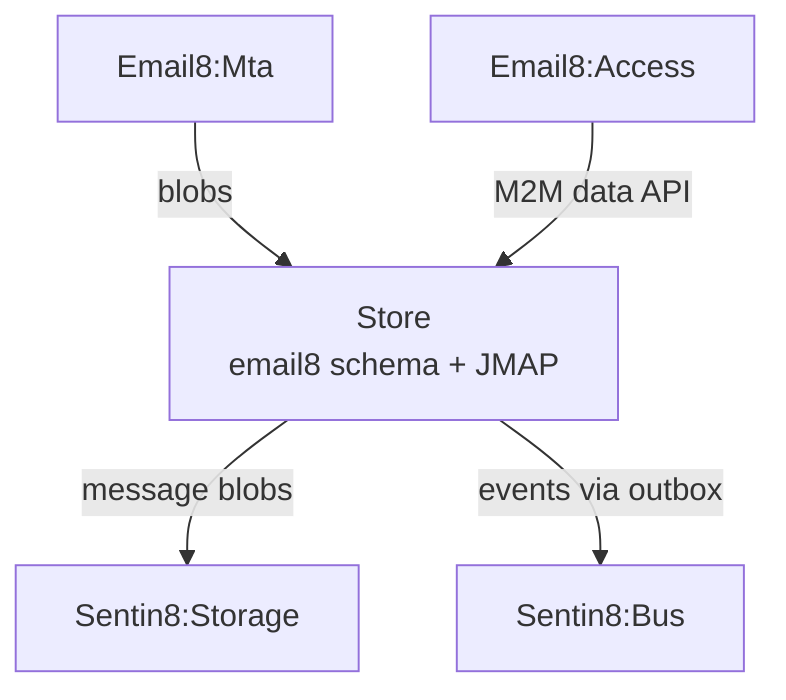

# Sentin8 Email8:Store — Mail & Collaboration Data Core

## 1. Summary

Email8:Store is the mail plane's data core: mailboxes, messages,
folders, contacts, calendars (the `email8` schema), plus the JMAP
API — the authenticated read/write surface for the other mail
services and user clients.

## 2. Architecture

## 3. Key Traits

- Owns the `email8` database schema (mailboxes, messages, groupware)
  with standard RLS discipline.
- Message blobs go to Sentin8:Storage; Store keeps the metadata +
  indexes.
- M2M: certificate identity (CERTFREE-4V) — internal callers present
  their workload certs; bus events via the local outbox →
  produce API (inbox-first).

See the vertical group docs (`email8/README.md`) for the plane
overview.

---

**Design attribution:** email8:store and its underlying concepts were designed by Hamid Jahanzad <Hamid@Jahanzad.com>.
