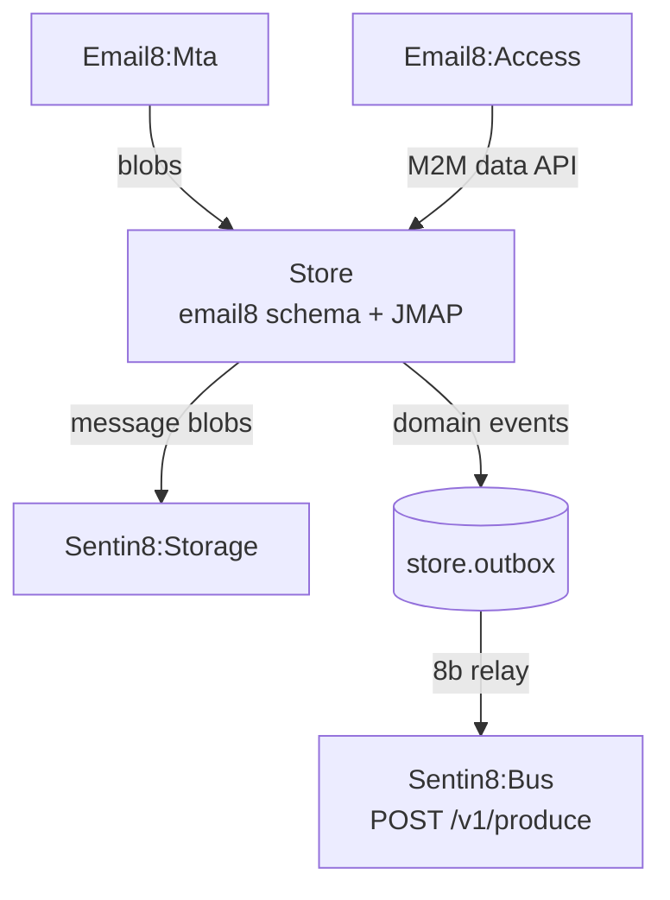

# Sentin8 Email8:Store - Mail & Collaboration Data Core

## 1. Summary

Email8:Store is the mail plane's data core: mailboxes, messages,
folders, contacts, calendars (the `email8` schema), plus the JMAP
API - the authenticated read/write surface for the other mail
services and user clients.

## 2. Architecture

## 3. Key Traits

- Owns the `email8` database schema (mailboxes, messages, groupware)
  with standard RLS discipline: account-scoped tables
  (holder-or-admin tier), env-scoped config tables, `principals` as
  the env-tier root (writes service-layer-gated; SELECT admits the
  auth-user holder-match), and `domains` as the NO-RLS mail-domain→env
  discovery catalog (the MTA resolves recipient domains pre-tenant -
  the bank8-fdx `provider_profiles` precedent; design
  `../../design/sentin8-provisioned-rls-and-telemetry-design.md`).
  The tenant context is transaction-local: every stamp + query
  sequence runs inside ONE explicit transaction on ONE connection.
- The local outbox lives in the `store` leaf schema (`store.outbox`,
  OUTBOX-EMAIL8 - the DBX producer path; the shell's 8b relay drains
  it to Bus `POST /v1/produce`, idempotency_key = row id).
- Audit journal (AUDJOUR-1, architecture-principles §6.8): the
  `store.audit_journal` leaf-schema table (migration v4 - the 15-column
  `sentin8_audit::audit_journal_sql` contract) is drained to Sys
  `POST /v1/audit` by the shell's boot-8c pusher, presenting the
  `store-audit` workload certificate (`sentin8:sys:audit:write`).
- Message blobs go to Sentin8:Storage; Store keeps the metadata +
  indexes.
- M2M: certificate identity (CERTFREE-4V) - internal callers present
  their workload certs; bus events via the local outbox →
  produce API (inbox-first).

See the vertical group docs (`email8/README.md`) for the plane
overview.

---

**Design attribution:** email8:store and its underlying concepts were designed by Hamid Jahanzad <Hamid@Jahanzad.com>.
